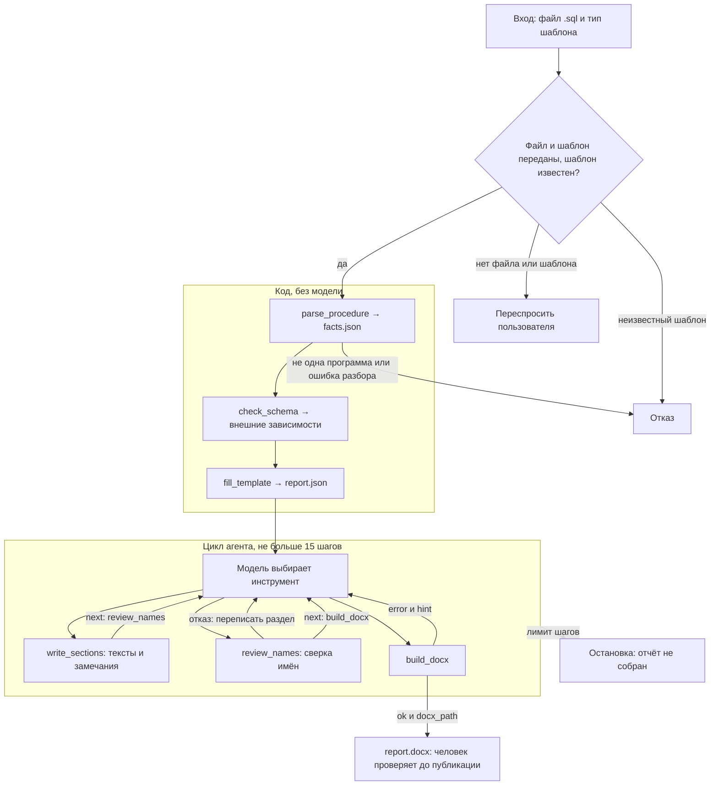

# С1. Описание хранимой процедуры в .docx

## Команда

Егор Гудков.

## Задача

В компании бизнес-логика транспортных процессов живёт в хранимых процедурах PostgreSQL на
plpgsql: приём сообщений, регистрация заявок, расчёт планов, отчётные функции. На каждую
такую программу нужен структурированный отчёт в .docx, и у каждого типа задачи свой шаблон.
Сейчас отчёты пишут руками. Агент получает файл с процедурой и тип шаблона, разбирает код,
строит отчёт по шаблону и отдаёт .docx вместе с замечаниями: что в коде осталось неясным,
где комментарий противоречит коду, какие внешние зависимости не описаны. Человек проверяет
отчёт до публикации.

Главное требование: **в отчёте нет ни одной таблицы, функции, параметра или статуса,
которых нет в разборе кода.** Разбор делает инструмент, текст пишет модель, проверяет
отдельный ревьюер. Это главный тест проекта.

## Вход

Файл `.sql` с одной процедурой или функцией plpgsql; тип шаблона («описание
процесса» или «описание интеграции»); по желанию схема базы для сверки имён.

## Выход

Отчёт `.docx` по разделам шаблона; список замечаний: неясные места,
комментарии, противоречащие коду, внешние зависимости без определения, пустые разделы;
извлечённые факты в JSON для проверки.

## Стек технологий

- Python 3.11+.
- LLM через прокси курса (OpenAI-совместимый API), модель на выбор команды.
- Логирование вызовов инструментов: файл, SQLite или Langfuse.
- pytest для тестовых кейсов.
- Разбор SQL и plpgsql: библиотека `pglast` (обёртка над парсером PostgreSQL, есть `parse_plpgsql`), при необходимости свой обход дерева.
- Сборка docx: python-docx по шаблону; модель к docx не прикасается.
- Глоссарий и сделанные отчёты: SQLite или JSON.
- Интерфейс: веб-форма.

## Данные

Для отладки агента в `data/` лежат схема учебной базы и четыре процедуры. Состав разделов
отчёта для каждого типа шаблона команда берёт из своих рабочих шаблонов и описывает в решении.

### `data/schema.sql`

Схема учебной базы: справочники дорог, станций, родов вагонов, клиентов и операций, очередь
входящих сообщений, дислокация и журнал операций по вагонам, парк, заявки ГУ-12 с историей
статусов, суточный план подач, факт выгрузки и месячный план. Имена колонок те же, что в
витринах набора курса; их смысл описан в `datamarts.student.json` набора курса.

### `data/procedures/` — четыре программы разной формы и разного качества

| Файл | Что делает | Чем интересна |
|---|---|---|
| `01_accept_disloc_message.sql` | процедура принимает сообщение о вагонной операции из очереди, проверяет, пишет журнал, обновляет дислокацию и парк, ставит статус сообщению | подробные комментарии, идемпотентность по идентификатору сообщения, блокировка строки, опоздавшие сообщения, блок обработки исключений по кодам |
| `02_register_gu12_order.sql` | функция регистрирует заявку ГУ-12: восемь проверок, поиск дубля, автоподтверждение до 50 вагонов, вызов внешней функции уведомления | комментариев нет совсем, описание строится только по коду; внешняя функция в схеме не определена |
| `03_build_daily_supply_plan.sql` | процедура строит суточный план подач: удаляет старый план, собирает свободный парк во временную таблицу, курсором раздаёт вагоны по заявкам, меняет статусы | комментарии местами врут: «в порядке приоритета клиента», а в коде сортировка по времени создания; временная таблица, `GET DIAGNOSTICS`, `CONTINUE` в цикле |
| `04_road_unload_report.sql` | функция возвращает таблицу: факт выгрузки по станциям дороги против месячного плана, приведённого к дням периода | `RETURNS TABLE`, `STABLE`, несколько CTE и подзапрос в выражении, три проверки без кодов ошибок |

## Решение

Решение делится на две части: шаги без выбора выполняет код, шаги с решениями — модель.

Разбор процедуры, сверка со схемой и раскладка фактов по шаблону всегда идут в одном порядке, поэтому их выполняет код до запуска модели. Модель получает готовый каркас отчёта и работает с тремя инструментами: пишет текст разделов и замечания (`write_sections`), запускает проверку имён (`review_names`) и собирает документ (`build_docx`). Остановку, лимит шагов и счётчик попыток тоже держит код.

### Схема пайплайна



### Шаги

**Шаг 0. Приём входа (код).** Код проверяет, что переданы файл `.sql` и тип шаблона. Если чего-то нет, он переспрашивает пользователя. Неизвестный тип шаблона — отказ. Модель на этом шаге не вызывается.

**Шаг 1. `parse_procedure` (код).** Читает файл с диска и пишет `facts.json`. Текст процедуры не проходит через аргументы модели, поэтому номера строк не сбиваются. Разбор идёт в три прохода:

- `parse_syntax`. `pglast.parse_plpgsql` даёт дерево тела с номерами строк операторов. SQL внутри оператора приходит строкой, и код разбирает его отдельно через `pglast.parse_sql`. Позиция внутри такой строки — это смещение от её начала, поэтому номер строки в файле код находит поиском текста по исходнику. Из дерева извлекаются параметры, таблицы, статусы, вызовы, проверки и сортировки. У каждого факта есть `id` и `line`. Таблицы, которые создаёт сама программа (временные таблицы, CTE), получают `defined_here: true`.
- `parse_comments`. Строки `--` с номерами строк.
- `join_by_statement`. Комментарий привязывается к следующему оператору целиком, от его первой строки до `;`, и в `near_ids` попадают все факты этого оператора. Комментарий перед `CREATE` относится ко всей программе. Если ниже в блоке нет оператора, комментарий привязывается к предыдущему.

Ещё в `facts.json` записывается `allowed_words` — все латинские слова исходника: идентификаторы, ключевые слова и строковые константы. По этому списку работает `review_names`.

Отказ: в файле не одна программа plpgsql или код не разобран.

**Шаг 2. `check_schema` (код).** Сверяет таблицы и вызовы из `facts.json` с `data/schema.sql`. Не проверяются:

- объекты с `defined_here: true`, например `tmp_free_park` в `03` и CTE `days`, `fact`, `plan` в `04`;
- встроенные функции PostgreSQL (`count`, `sum`, `upper`, `btrim`, `now`, `round`, `generate_series` и другие). Их список лежит в коде.

Всё остальное, чего нет в схеме, становится замечанием `external_dependency`.

**Шаг 3. `fill_template` (код).** По `templates.json` раскладывает факты по разделам выбранного шаблона и создаёт `report.json`. У каждого раздела есть `id`, `title`, `facts`, пустой `text`, поле `review` и `attempts: 0`. Комментарий попадает в тот раздел, где лежат факты из его `near_ids`. Раздел без фактов сразу получает `review: "empty"` и замечание `empty_section`, модель его не пишет.

**Шаг 4. `write_sections` (модель).** Модель пишет фразу для каждого раздела с фактами и добавляет замечания:

- `comment_contradicts_code` — комментарий не совпадает с фактами из своих `near_ids`;
- `unclear` — место в коде, смысл которого из кода не ясен.

У каждого замечания есть `fact_ids`. Код записывает текст в `report.json` и отклоняет замечание, если какого-то из его `fact_ids` нет в `facts.json`.

**Шаг 5. `review_names` (модель вызывает, проверяет код).** Из каждой фразы и каждого замечания код достаёт все латинские слова (`[A-Za-z_][A-Za-z0-9_]*`). Каждое слово без учёта регистра сравнивается с `allowed_words` и коротким списком общих слов (`SQL`, `PostgreSQL`, `plpgsql`, `JSON`). Если все слова есть в списках, раздел получает `ok`. Если есть лишнее слово, раздел получает `rejected`: фраза в отчёт не идёт, лишние слова записываются в `unknown_names`, `attempts` увеличивается на 1.

**Шаг 6. Повтор.** Модель переписывает через `write_sections` только отклонённые разделы и снова вызывает `review_names`. Второй отказ закрывает раздел: `review: "closed"`, замечание `unknown_name`.

**Шаг 7. `build_docx` (модель вызывает, собирает код).** Собирает `.docx` через python-docx из разделов со статусом `ok` и из всех замечаний. Модель к файлу не прикасается. Если после последнего `write_sections` проверки не было, инструмент сначала сам запускает `review_names`.

**Шаг 8. Остановка (код).** Цикл завершается, как только `build_docx` вернул `ok: true` и `docx_path`. Человек читает отчёт до публикации.

### Что считается фактом

| Вид | Что это | Пример |
|---|---|---|
| `parameter` | параметр программы | `p_plan_date` |
| `object` | таблица, с которой работает программа, и действия с ней: `select`, `insert`, `update`, `delete` | `gu12_order`: `select`, `update` |
| `status` | строковая константа, которую сравнивают с колонкой `status`, `state`, `old_status`, `new_status` или записывают в неё; текст `reason` и сообщения `RAISE` статусами не считаются | `'CONFIRMED'`, `'FREE'` |
| `call` | вызов функции или процедуры, кроме встроенных | `fn_notify_dispatcher` |
| `check` | `IF ... RAISE EXCEPTION`: условие, текст и код ошибки, если он есть | `P0006` |
| `ordering` | `ORDER BY` с колонками | `created_at` |
| `comment` | строка `--` с `near_ids` | `c13` |

### Шаблоны

Разделы шаблонов и правило «какой вид факта идёт в какой раздел» лежат в `templates.json`. Раздел `statuses` есть в обоих шаблонах, чтобы пустые статусы попадали в замечания.

| `id` раздела | «описание процесса» | «описание интеграции» | Факты |
|---|---|---|---|
| `purpose` | Назначение | Назначение | имя и вид программы, комментарии перед `CREATE` |
| `params` | Параметры | Входные данные | `parameter` |
| `checks` | Проверки | Проверки входных данных | `check` |
| `objects` | Таблицы и действия | Затрагиваемые таблицы | `object` |
| `steps` | Порядок обработки | — | `ordering` и комментарии внутри тела |
| `statuses` | Статусы | Статусы | `status` |
| `calls` | Внешние вызовы | Вызовы смежных систем | `call` |

### Пример: комментарий против кода в `03`

Комментарий на строке 13 стоит перед объявлением курсора, которое занимает строки 14–20. Поэтому в `near_ids` попадают все факты курсора, включая сортировку `ORDER BY o.created_at` на строке 20:

```json
{
  "comments": [
    {
      "id": "c13",
      "line": 13,
      "text": "заявки берём в порядке приоритета клиента",
      "near_ids": ["obj_gu12_order", "st_confirmed", "par_p_plan_date", "par_p_st_code", "ord_orders"]
    }
  ],
  "orderings": [
    {"id": "ord_orders", "line": 20, "columns": ["created_at"]}
  ]
}
```

Модель сравнивает комментарий с фактами и передаёт в `write_sections` замечание:

```json
{
  "kind": "comment_contradicts_code",
  "fact_ids": ["c13", "ord_orders"],
  "text": "Комментарий говорит о порядке по приоритету клиента, а курсор сортирует заявки по created_at."
}
```

## Память

Один запуск строит один отчёт. Между запусками модель ничего не помнит, прошлые отчёты в новый запрос не подставляются.

Состояние запуска хранит код, а не модель. На диске лежат:

- `facts.json` — факты разбора и `allowed_words`;
- `report.json` — разделы с текстом, статусом проверки и счётчиком попыток, а также замечания;
- журнал вызовов — для каждого шага инструмент, аргументы и ответ.

В окне модели остаётся диалог этого запуска: вызовы инструментов и их ответы.

## Инструменты

[tools.json](tools.json) — набросок схем вызова, не проработанная схема.

### Шаги кода

Модель их не вызывает, код выполняет их по порядку до запуска цикла.

| Шаг | Вход | Выход | Что делает |
|---|---|---|---|
| `parse_procedure` | путь к файлу `.sql` | `ok`; `error` — `not_one_routine` или `parse_error`; `routine` — вид и имя; `facts` — параметры, таблицы, статусы, вызовы, проверки, сортировки, комментарии с `near_ids`; `allowed_words` | Разбирает одну процедуру или функцию plpgsql и пишет `facts.json`. |
| `check_schema` | `facts.json`, `data/schema.sql` | `remarks` — таблицы и вызовы, которых нет в схеме | Сверяет зависимости со схемой, пропуская объекты с `defined_here` и встроенные функции. |
| `fill_template` | тип шаблона, `facts.json`, `templates.json` | `report.json` — разделы с `id`, `title`, `facts`, пустым `text`, `review`, `attempts`; замечания `empty_section` | Раскладывает факты по разделам шаблона. |

### Инструменты модели

В каждом ответе есть `ok`. При ошибке инструмент возвращает `error` и `hint` с правильным следующим шагом, при успехе — `next`.

| Инструмент | Вход | Выход | Что делает |
|---|---|---|---|
| `write_sections` | `sections` — список `{id, text}`; `remarks` — список `{kind, fact_ids, text}`, где `kind` — `comment_contradicts_code` или `unclear` | `written` — `id` записанных разделов; `missing` — `id`, которых нет в каркасе; `skipped` — пустые и закрытые разделы; `bad_remarks` — замечания с несуществующими `fact_ids`; `next` | Записывает фразы и замечания в `report.json`. |
| `review_names` | — | `sections` — у каждого раздела `review` (`ok`, `rejected`, `empty`, `closed`), `unknown_names` и `attempts`; `rejected_ids`; `remarks`; `next` | Сверяет латинские слова фраз и замечаний с `allowed_words`, считает попытки и закрывает раздел после второго отказа. |
| `build_docx` | — | `docx_path`; `included_sections` — разделы в документе; `remarks` — замечания в документе | Собирает `.docx` из разделов `ok` и замечаний. Если свежей проверки не было, сначала запускает `review_names`. |

## Контекст

В каждый запрос к модели входят:

- постоянный текст: роль, задача, порядок вызовов и правила из раздела «Управление рассуждением»;
- схемы трёх инструментов модели;
- первое сообщение запуска: тип шаблона, текст процедуры с номерами строк, каркас `report.json` с фактами по разделам и замечания `check_schema`;
- диалог запуска: вызовы инструментов и их ответы, поэтому модель видит, что уже сделано.

Текст процедуры модель только читает, чтобы понимать логику и находить неясные места. Имена во фразах всё равно проверяются по `allowed_words`. `data/schema.sql` и прошлые отчёты в окно не входят.

## Управление рассуждением

Модель выбирает следующий инструмент по трём подсказкам: порядку в постоянном тексте (`write_sections` → `review_names` → `build_docx`), полю `next` в последнем ответе инструмента и полю `hint`, если инструмент вернул ошибку. Выбор модели вероятностный, поэтому правила ниже держит код, а не промпт.

1. **Вход проверяется до цикла.** Нет файла или шаблона — код переспрашивает пользователя. Неизвестный шаблон, не одна программа в файле или ошибка разбора — отказ. Модель в этих случаях не вызывается.
2. **Остановка.** Цикл завершается кодом, как только `build_docx` вернул `ok: true` и `docx_path`. Модель для этого ничего не должна сообщать.
3. **Лимит шагов.** К модели не больше 15 обращений. Если лимит исчерпан, код останавливается с сообщением «отчёт не собран» и сохраняет журнал.
4. **Ответ без вызова инструмента.** Если модель ответила текстом до сборки, код один раз напоминает: «отчёт не собран, вызови `build_docx`». Второй такой ответ — остановка с сообщением «отчёт не собран».
5. **Предусловия.** Каждый инструмент сам проверяет, можно ли его вызвать, и при ошибке возвращает `error` и `hint`. Например, `review_names` до первой записи текста возвращает `error: "no_text"` и `hint: "вызови write_sections"`.
6. **Подсказка следующего шага.** После `write_sections` поле `next` указывает `review_names`. После `review_names` без открытых отказов — `build_docx`, с отказами — `write_sections` для `rejected_ids`.
7. **Попытки.** Счётчик `attempts` хранится в `report.json`. Раздел можно переписать один раз, второй отказ закрывает его: `review: "closed"`, замечание `unknown_name`, в `.docx` раздел не идёт. Запись в закрытый или пустой раздел код пропускает и возвращает в `skipped`.
8. **Сборка без свежей проверки.** Если после последнего `write_sections` не было `review_names`, `build_docx` сначала запускает проверку сам.
9. **Замечания модели.** Принимаются только с существующими `fact_ids` и проходят ту же проверку имён, что и разделы.

## Оценка

Отчёт принимается, если каждое латинское слово в `.docx` есть в `allowed_words` или в списке общих слов, то есть в отчёте нет ни одной таблицы, функции, параметра или статуса, которых нет в коде.

Проверки без модели (pytest):

- разбор: факты и номера строк на четырёх процедурах;
- склейка: в `03` у `c13` в `near_ids` есть `ord_orders`;
- сверка со схемой: в `02` есть `fn_notify_dispatcher`, но нет `btrim` и `upper`; в `03` нет `tmp_free_park`; в `04` нет `days`, `fact`, `plan`;
- `review_names`: фраза с выдуманным именем получает `rejected`, второй отказ закрывает раздел;
- сборка `.docx` из готового `report.json`: в файл попадают только разделы `ok`;
- цикл с поддельной моделью, которая отвечает по заготовленному сценарию: срабатывают остановка после `build_docx`, лимит шагов и напоминание при ответе без вызова.

Проверки на четырёх процедурах с моделью:

- `01` — отчёт собирается, статусы только из кода;
- `02` — в замечаниях есть `fn_notify_dispatcher`;
- `03` — есть замечание `comment_contradicts_code` с `fact_ids` `c13` и `ord_orders`;
- `04` — пустой раздел статусов лежит в замечаниях.

Отдельная проверка: во фразу подставляется имя, которого нет в коде. В `.docx` его быть не должно. Журнал вызовов показывает, какие инструменты модель выбрала.
