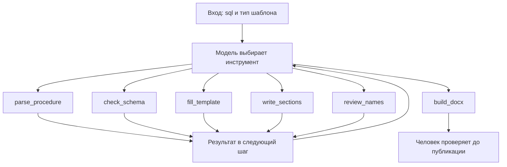

# С1. Описание хранимой процедуры в .docx

## Команда

Егор Гудков.

## Задача

В компании бизнес-логика транспортных процессов живёт в хранимых процедурах PostgreSQL на
plpgsql: приём сообщений, регистрация заявок, расчёт планов, отчётные функции. На каждую
такую программу нужен структурированный отчёт в .docx, и у каждого типа задачи свой шаблон.
Сейчас отчёты пишут руками. Агент получает файл с процедурой и тип шаблона, разбирает код,
строит отчёт по шаблону и отдаёт .docx вместе с замечаниями: что в коде осталось неясным,
где комментарий противоречит коду, какие внешние зависимости не описаны. Человек проверяет
отчёт до публикации.

Главное требование: **в отчёте нет ни одной таблицы, функции, параметра или статуса,
которых нет в разборе кода.** Разбор делает инструмент, текст пишет модель, проверяет
отдельный ревьюер. Это главный тест проекта.

## Вход

Файл `.sql` с одной процедурой или функцией plpgsql; тип шаблона («описание
процесса» или «описание интеграции»); по желанию схема базы для сверки имён.

## Выход

Отчёт `.docx` по разделам шаблона; список замечаний: неясные места,
комментарии, противоречащие коду, внешние зависимости без определения, пустые разделы;
извлечённые факты в JSON для проверки.

## Стек технологий

- Python 3.11+.
- LLM через прокси курса (OpenAI-совместимый API), модель на выбор команды.
- Логирование вызовов инструментов: файл, SQLite или Langfuse.
- pytest для тестовых кейсов.
- Разбор SQL и plpgsql: библиотека `pglast` (обёртка над парсером PostgreSQL, есть `parse_plpgsql`), при необходимости свой обход дерева.
- Сборка docx: python-docx по шаблону; модель к docx не прикасается.
- Глоссарий и сделанные отчёты: SQLite или JSON.
- Интерфейс: веб-форма.

## Данные

Для отладки агента в `data/` лежат схема учебной базы и четыре процедуры. Состав разделов
отчёта для каждого типа шаблона команда берёт из своих рабочих шаблонов и описывает в решении.

### `data/schema.sql`

Схема учебной базы: справочники дорог, станций, родов вагонов, клиентов и операций, очередь
входящих сообщений, дислокация и журнал операций по вагонам, парк, заявки ГУ-12 с историей
статусов, суточный план подач, факт выгрузки и месячный план. Имена колонок те же, что в
витринах набора курса; их смысл описан в `datamarts.student.json` набора курса.

### `data/procedures/` — четыре программы разной формы и разного качества

| Файл | Что делает | Чем интересна |
|---|---|---|
| `01_accept_disloc_message.sql` | процедура принимает сообщение о вагонной операции из очереди, проверяет, пишет журнал, обновляет дислокацию и парк, ставит статус сообщению | подробные комментарии, идемпотентность по идентификатору сообщения, блокировка строки, опоздавшие сообщения, блок обработки исключений по кодам |
| `02_register_gu12_order.sql` | функция регистрирует заявку ГУ-12: восемь проверок, поиск дубля, автоподтверждение до 50 вагонов, вызов внешней функции уведомления | комментариев нет совсем, описание строится только по коду; внешняя функция в схеме не определена |
| `03_build_daily_supply_plan.sql` | процедура строит суточный план подач: удаляет старый план, собирает свободный парк во временную таблицу, курсором раздаёт вагоны по заявкам, меняет статусы | комментарии местами врут: «в порядке приоритета клиента», а в коде сортировка по времени создания; временная таблица, `GET DIAGNOSTICS`, `CONTINUE` в цикле |
| `04_road_unload_report.sql` | функция возвращает таблицу: факт выгрузки по станциям дороги против месячного плана, приведённого к дням периода | `RETURNS TABLE`, `STABLE`, несколько CTE и подзапрос в выражении, три проверки без кодов ошибок |

## Решение

На вход приходят файл `.sql` и тип шаблона. Схему программа читает из `data/schema.sql`. Дальше идёт цикл: модель на каждом шаге выбирает один инструмент, программа его выполняет и возвращает результат в следующий шаг. Фразы разделов модель передаёт аргументом `write_sections`. Код записывает их в `report.json`. Файл `.docx` собирает `build_docx` из разделов, которые `review_names` пометил как `ok`.

В промпте задан такой порядок вызовов:

1. `parse_procedure` пишет `facts.json`. Внутри три прохода: `parse_syntax` через `pglast` (параметры, таблицы, статусы, вызовы, проверки, сортировки, у каждого факта `id` и номер строки), `parse_comments` (строки `--`), `join_by_line` (`near_id` ближайшего факта ниже, иначе ближайшего выше).
2. `check_schema` сравнивает вызовы и таблицы из `facts.json` с `data/schema.sql`. Нет в схеме — замечание о зависимости без определения. Временная таблица, созданная в процедуре, в замечание не идёт.
3. `fill_template` создаёт `report.json`: факты разложены по разделам выбранного шаблона, у раздела есть `id`, список фактов и пустой `text`. Раздел без фактов остаётся пустым.
4. `write_sections`: модель передаёт фразу на каждый раздел с тем же `id`. Код записывает её в `text`. Пропущенный `id` остаётся пустым.
5. `review_names` проходит по разделам. Во фразе ищет таблицы, функции, параметры и статусы и сверяет их с `facts.json`. Все имена на месте — `ok`. Лишнее имя — фраза в отчёт не идёт и пишется в `remarks`. Пустой раздел тоже пишется в `remarks`.
6. Если есть раздел с отказом, модель вызывает `write_sections` только для него и снова `review_names`.
7. `build_docx` читает `report.json`. Раздел без `ok` в файл не попадает. Если модель вызвала сборку до проверки, инструмент сначала сам запускает `review_names`.
8. Цикл останавливается, когда `build_docx` вернул путь к файлу. Человек читает отчёт до публикации.



Комментарий на строке 13 в `03_build_daily_supply_plan.sql` относится к курсору со строки 14:

```json
{
  "comments": [
    {
      "id": "c13",
      "line": 13,
      "text": "заявки берём в порядке приоритета клиента",
      "near_id": "ord_orders"
    }
  ],
  "orderings": [
    {"id": "ord_orders", "line": 14, "columns": ["created_at"]}
  ]
}
```

## Память

Один запуск строит один отчёт. Между запусками модель ничего не помнит, прошлые отчёты в новый запрос не подставляются.

Внутри запуска на диске лежат `facts.json`, `report.json` и журнал вызовов. В окне остаётся диалог этого запуска: вызовы инструментов и их ответы.

В каждый запрос добавляется один и тот же текст: роль, задача и порядок вызовов. Схемы инструментов передаются отдельно.

## Инструменты

[tools.json](tools.json) — набросок схем вызова, не проработанная схема.

| Инструмент | Вход | Выход | Что делает |
|---|---|---|---|
| `parse_procedure` | `sql` — текст процедуры | `ok` — разбор удался; `error` — в файле не одна процедура или код не разобран; `routine` — вид и имя; `facts` — параметры, таблицы, статусы, вызовы, проверки, сортировки и комментарии | Разбирает одну процедуру или функцию plpgsql и возвращает факты кода с комментариями. |
| `check_schema` | — | `ok` — сверка выполнена; `error` — разбора ещё нет; `remarks` — вызовы и таблицы, которых нет в схеме | Сверяет вызовы и таблицы текущего разбора с `data/schema.sql`. |
| `fill_template` | `template` — «описание процесса» или «описание интеграции» | `ok` — каркас собран; `error` — неизвестный тип или нет разбора; `template` — выбранный тип; `sections` — разделы с `id`, заголовком, фактами и пустым `text` | Раскладывает факты по разделам шаблона и возвращает каркас с пустым `text`. |
| `write_sections` | `sections.id` — идентификатор раздела; `sections.text` — фраза этого раздела | `ok` — запись прошла; `error` — каркаса ещё нет; `written` — разделы, куда фраза записана; `missing` — `id`, которых нет в каркасе | Записывает фразы разделов в `report.json` по `id`. |
| `review_names` | — | `ok` — проверка выполнена; `error` — нет каркаса или разбора; `sections` — у каждого раздела `ok`, отказ или пусто и список лишних имён; `remarks` — замечания по разделам | Сверяет таблицы, функции, параметры и статусы во фразах с `facts.json`. |
| `build_docx` | — | `ok` — файл собран; `error` — каркаса ещё нет; `docx_path` — путь к файлу; `included_sections` — разделы, попавшие в документ; `remarks` — замечания, которые попали в документ | Собирает `.docx` из разделов со статусом `ok` и из замечаний. Если проверки имён ещё не было, выполняет её перед сборкой. |

## Контекст

В каждый шаг входят постоянный текст (роль, задача, порядок вызовов), схемы инструментов и диалог текущего запуска. В диалоге остаются вызовы инструментов и их ответы, поэтому модель видит, что уже сделано.

На первом шаге к этому добавляются текст процедуры и тип шаблона. `data/schema.sql` и прошлые отчёты в окно не входят. Следующий инструмент берётся из порядка в постоянном тексте и из уже лежащих в диалоге ответов: после `parse_procedure` вызывается `check_schema`, `write_sections` — после `fill_template`, когда в диалоге уже есть `id` разделов.

## Управление рассуждением

Модель выбирает следующий инструмент по диалогу этого запуска и по порядку вызовов в постоянном тексте. Останавливается, когда `build_docx` вернул путь к файлу. Переспрашивает, если не передан файл или тип шаблона. Отказывает, если в файле не одна процедура `plpgsql`, тип шаблона неизвестен или `parse_procedure` не смог разобрать код. После отказа `review_names` модель может ещё раз вызвать `write_sections` для отклонённых разделов. Второй отказ того же раздела закрывает его замечанием.

## Оценка

Отчёт принимается, если каждое имя таблицы, функции, параметра и статуса в `.docx` есть в `facts.json`.

Проверки без модели: разбор, склейка комментария по номеру строки, сверка со схемой, `review_names`, сборка `.docx`.

Проверки на четырёх процедурах:

- `01` — отчёт собирается, статусы только из кода;
- `02` — в замечаниях есть `fn_notify_dispatcher`;
- `03` — в замечаниях спор комментария про приоритет клиента с сортировкой по `created_at`;
- `04` — пустой раздел статусов лежит в замечаниях.

Отдельная проверка: во фразу подставляется имя, которого нет в `facts.json`. В `.docx` его быть не должно. Журнал вызовов показывает, какие инструменты модель выбрала.
